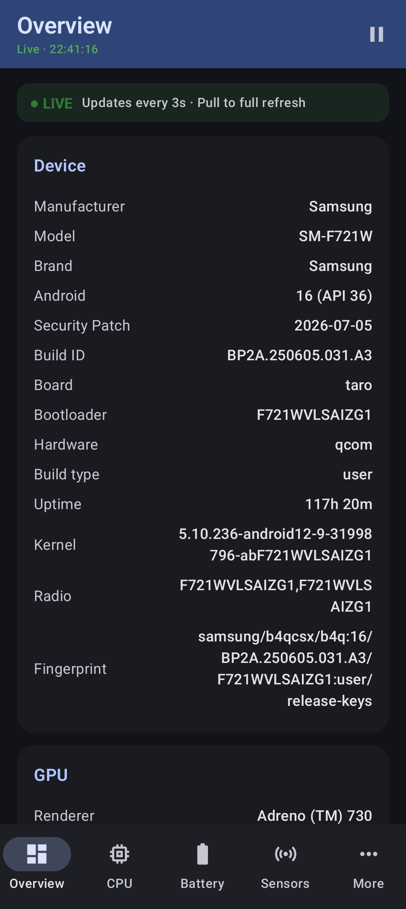
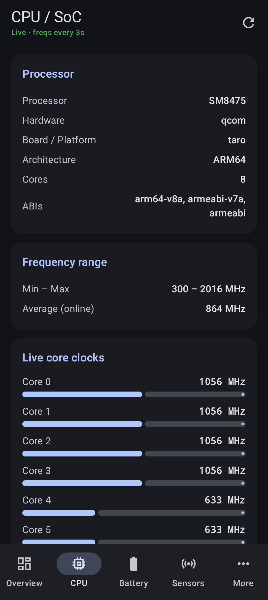
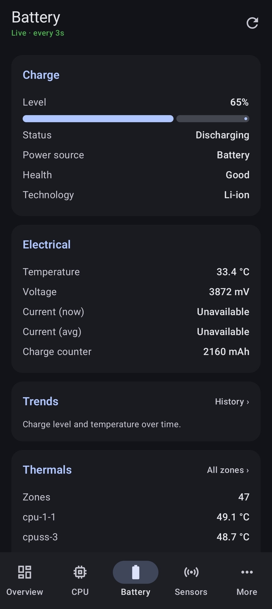
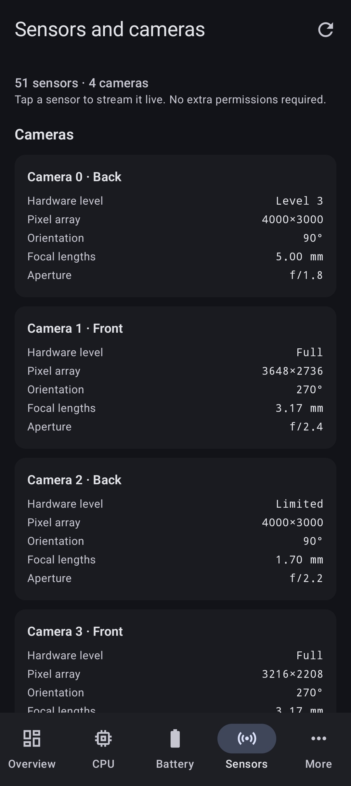
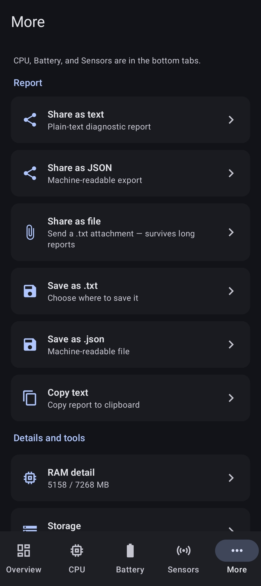

# Phone Diagnostic Tool

Privacy-focused Android diagnostics: CPU, GPU, battery, RAM, storage, display, sensors, cameras, and optional network latency — all on-device.

**No accounts. No analytics SDKs. No cloud upload of reports.**

[](https://github.com/ScoobyDouche/PhoneDiagnosticTool/releases/latest)
[](https://github.com/ScoobyDouche/PhoneDiagnosticTool/actions/workflows/build-apk.yml)

## Screenshots

| Overview | CPU / SoC | Battery | Sensors | More |
|:--:|:--:|:--:|:--:|:--:|
|  |  |  |  |  |

Captured on a Galaxy Z Flip4 running Android 16.

## Features

- **Device overview** — model, Android version, security patch, fingerprint, board, bootloader, uptime
- **CPU / SoC** — architecture, frequency range, live per-core clocks, cluster layout, governors, available frequencies
- **GPU** — OpenGL ES info
- **Battery** — charge, health, temperature, voltage, thermal zones, charging power, cycle count (where available)
- **RAM** — usage, kernel stats (cached, buffers, swap, ZRAM) + process detail (system-wide with Shizuku/root)
- **Storage** — volumes + per-app breakdown (requires Usage Access)
- **Display** — refresh rates, HDR formats, wide colour gamut
- **Sensors** — list, reporting mode / wake-up / batching, live streaming with per-axis charts
- **Cameras** — facing, pixel array, focal lengths, hardware level, ISO / exposure ranges, flash, capabilities (no capture permission needed)
- **Connectivity** — NFC / Bluetooth state, connected audio devices
- **Security** — verified boot, bootloader lock, encryption, SELinux mode, build tags
- **Network** — IP addresses, DNS / private DNS, Wi-Fi link speed / band / signal, carrier, optional latency probe + 5-probe burst stats
- **History** — battery, temperature and RAM trends from up to 24 h of on-device samples
- **Tools** — CPU load test (1 / 5 / 10 min) with k-ops/s score, vibration check, storage speed test
- **Background monitor** — rotating log (capped at 5000 lines)
- **Reports** — share as text / JSON / file, save, or copy
- **Elevated access** (optional, off by default) — Shizuku or root for fuel-gauge health, per-core clocks, and system process list
- Theme: system / light / dark
- Fully externalised strings (ready for translation packs)

## Privacy

See **[PRIVACY.md](PRIVACY.md)**.

Short version: everything stays on the device. The only network use is an optional latency probe you can disable in Settings.

## Download

**[Latest release](https://github.com/ScoobyDouche/PhoneDiagnosticTool/releases/latest)** — grab the `.apk`. Allow install from unknown sources when prompted.

Releases are signed with a private release key (when the four GitHub secrets are configured). CI debug builds use a fixed keystore so they install over each other.

### Usage Access blocked after sideload (Android 13+)

Per-app storage needs **Usage Access**. On sideloaded apps Android treats this as a restricted setting:

1. **Settings → Apps → Phone Diagnostic**
2. **⋮** (top right) → **Allow restricted settings** (confirm with PIN / biometrics)
3. Back in the app: **Storage → Open Usage Access** and enable the toggle

Overall volume sizes work without this. Only the per-app breakdown needs it.

**CI artifacts** (Actions → **Build APK** → latest green run) expire after 14 days:

| Artifact | Contents |
|----------|----------|
| `PhoneDiagnostic-debug` | Debug-signed APK |
| `PhoneDiagnostic-release-apk` | Release APK |
| `PhoneDiagnostic-release-aab` | Play-ready AAB |

## Stores

Packaging is ready; store accounts and listings are still manual.

- **Google Play** — upload the release AAB; enroll in Play App Signing
- **F-Droid** — draft metadata in [`metadata/com.phonediagnostic.yml`](metadata/com.phonediagnostic.yml)

Full checklist: **[docs/DISTRIBUTION.md](docs/DISTRIBUTION.md)**.

## Changelog

See **[CHANGELOG.md](CHANGELOG.md)**.

## Build from source

**Requirements:** JDK 17, Android SDK 35

```bash
git clone https://github.com/ScoobyDouche/PhoneDiagnosticTool.git
cd PhoneDiagnosticTool
# Optional: decode CI debug keystore for local parity
# base64 -d keystore/debug.keystore.b64 > keystore/debug.keystore
./gradlew test
./gradlew assembleDebug
./gradlew assembleRelease   # R8 + shrink; signs if RELEASE_* env is set
./gradlew bundleRelease     # AAB for Play
```

CI runs tests + debug/release APK + AAB on every push and pull request.

## Permissions

| Permission | Why |
|------------|-----|
| `INTERNET` | Optional latency measurement only |
| `ACCESS_NETWORK_STATE` | Detect connection type; DNS and link details |
| `ACCESS_WIFI_STATE` | Wi-Fi link speed, band, signal |
| `VIBRATE` | Vibration hardware check under Tools |
| `PACKAGE_USAGE_STATS` | Per-app storage (user must grant Usage Access) |
| `QUERY_ALL_PACKAGES` | List installed apps for the storage breakdown (Android 11+) |
| `REQUEST_DELETE_PACKAGES` | Uninstall from storage detail |
| `FOREGROUND_SERVICE` / `SPECIAL_USE` | Optional background monitor |
| `POST_NOTIFICATIONS` | Background monitor notification (Android 13+) |
| `moe.shizuku.manager.permission.API_V23` | Optional elevated access via Shizuku (off by default) |

Camera and sensors use system APIs without requesting the CAMERA permission (characteristics only; no capture).

## Tech

- Kotlin · Jetpack Compose · Material 3
- ViewModel + StateFlow
- Min SDK 26 · Target / compile SDK 35
- Version **1.3.1**

Diagnostics stay on-device only: a rotating log and 24 h metric history live in internal storage. The app opts out of Android cloud backup and device transfer (`allowBackup="false"`).

## License

[MIT](LICENSE)
